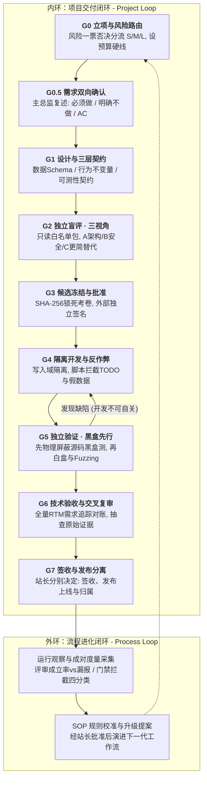

# 📘 O9-RD-MAO-Governance
### 从零构建高可靠多智能体系统：软件工程治理与 Multi-Agent 编排 (MAO) 完全指南

> **📌 项目简介 (About)**：从零构建高可靠多智能体系统（MAO）——融合软件工程治理思想（一源三轨、契约先行、黑盒先行、SHA-256 哈希防伪）的工业级 AI 研发工作流规范、完整理论蓝皮书与开箱即用定制 Meta-Prompt。  
> *(Industrial-grade Multi-Agent Orchestration Governance Framework & Complete Guide. Taming LLMs with Software Engineering discipline.)*
>
> **🏷️ 核心标签 (Topics)**：`multi-agent-systems` · `agent-orchestration` · `software-engineering` · `ai-governance` · `llm-workflow` · `design-by-contract` · `black-box-testing` · `o9-rd`

---

## 🌟 为什么你需要这个仓库？

市面上大多数野生 Multi-Agent 框架本质上是“让几个 AI 在群里自由聊天写代码”，在真实工程中极易死于四大绝症：**需求脑补放大**、**商业互吹审不出 Bug**、**删测试/写 `TODO` 假代码作弊（Reward Hacking）** 以及 **并发覆盖与死循环烧钱**。

本项目将人类软件工业积攒了 50 年的 **软件工程治理思想（Software Engineering Governance）** 降维打击引入多智能体编排：通过 **100% 确定性的软件工程控制面**（有限状态机、防伪基线、权限沙箱、黑白盒分离），将 **非确定性的 AI 执行面** 关进制度的笼子里，实现高可靠、可追溯的自动化研发交付。

---

## 📂 仓库核心目录与阅读导航

| 序号 | 文件入口 | 定位与适用场景 |
| :--- | :--- | :--- |
| 🛠️ **00** | **[《O9-RD Next V1.0 完整规范与实战模板》](./00-O9-RD-Next-V1.0-完整规范与实战模板.md)** | **【实战宪法与工具箱】** 含精简版 G0~G7 主规范、开箱即用的“核心四件套”文件模板（JSON/YAML/MD）及四大角色唤醒口令。 |
| 📕 **01** | **[《第一卷：破雾与筑基篇 (第 1~5 章)》](./01-Part1-破雾与筑基篇(第1-5章).md)** | **【零基础入门】** 解剖 Agent 四大器官、5 种协作拓扑、野生群聊四大灾难，确立“确定性控制面 vs 非确定性执行面”分离哲学与六大工程支柱。 |
| 📗 **02** | **[《第二卷：空间状态与流程质量篇 (第 6~11 章)》](./02-Part2-空间状态与流程质量篇(第6-11章).md)** | **【核心机制深潜】** 详解上下文防污染、四步哈希冻结与外部签名、三态分离、并发文件写入锁、风险路由、三层契约、A/B/C 三视角盲评与“黑盒先行”铁律。 |
| 📘 **03** | **[《第三卷：安全韧性演进篇与实战附录 (第 12~14 章 + 附录)》](./03-Part3-安全韧性演进篇与实战附录(第12-14章+附录).md)** | **【高阶保障与全量字典】** 涵盖 E2 沙箱六项正反向探测、C0-C3 四级变更、80% 残血安全交接、双环成对度量、人工埋雷校准，以及核心术语速查词典与主流框架对比。 |
| 🤖 **04** | **[《程序员 MAO 工作流定制教练 · Meta-Prompt》](./04-程序员MAO工作流定制教练-MetaPrompt.md)** | **【一键量体裁衣】** 将此提示词直接喂给 Claude / GPT / DeepSeek，AI 将化身敏捷工程教练，通过 4 个简单问题为你量身裁剪最适合当前项目的极简多智能体工作流！ |

---

## 🏗️ O9-RD 核心架构全景图（一源、三轨、双环治理）

---

## 🚀 3 分钟快速开始 (Quick Start)

1. **如果你想立刻让 AI 帮你定制一套轻量工作流**：
   直接打开 [`04-程序员MAO工作流定制教练-MetaPrompt.md`](./04-程序员MAO工作流定制教练-MetaPrompt.md)，复制全文发给你的日常 AI 助手（如 Claude / ChatGPT），回答它提出的 4 个小问题，即可拿到为你项目量身定做的极简文件模板与角色口令。
2. **如果你想直接启用完整的工业级 O9-RD 工作流**：
   打开 [`00-O9-RD-Next-V1.0-完整规范与实战模板.md`](./00-O9-RD-Next-V1.0-完整规范与实战模板.md)，将第二部分的 **“核心四件套模板”**（`project_state.json`、`spec_and_contracts.md`、`review_and_defects.yaml`、`rtm_acceptance.md`）复制到你的项目工作区即可启动。
3. **如果你想系统性学习 Multi-Agent 编排与软件工程治理理论**：
   请按顺序阅读 `01-Part1` -> `02-Part2` -> `03-Part3`。

---

## 📜 开源协议与版权署名 (License)

本项目采用 [MIT License](./LICENSE) 开源协议。  
Copyright © 2026 **曾威长/Over9rowth**. 欢迎自由阅读、引用、修改及在商业/个人项目中落地实践（请保留原作者 **曾威长/Over9rowth** 署名）。
