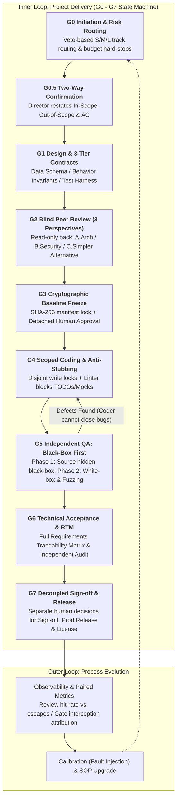

# 📘 O9-RD-MAO-Governance
### Industrial-Grade Multi-Agent Orchestration (MAO) & Software Engineering Governance Framework

  <strong>🌐 Language:</strong>
  <a href="./README_EN.md">🇬🇧 English</a> | 
  <a href="./README.md">🇨🇳 简体中文</a>

[-purple.svg)](https://github.com/Over9rowth)

> **Core Philosophy**: Never rely on an LLM's "self-discipline." Tame the **non-deterministic AI Execution Plane** using a **100% deterministic Software Engineering Control Plane** (Finite State Machines, SHA-256 immutable baselines, sandboxed least-privilege isolation, and Black-Box-First verification).

---

## 🔥 Why Do 90% of "Wild" Multi-Agent Coding Workflows Fail?

Most multi-agent setups treat software development like a casual group chat among LLMs. In real-world production engineering, they inevitably collapse due to four fatal flaws:
1. **Error Cascading**: A 5% requirement hallucination at step 1 compounds into 100% unusable code by step 5.
2. **Sycophancy (Mutual Flattery)**: When Reviewer agents read the Architect agent's self-praise in a shared context, they rubber-stamp critical security flaws.
3. **Reward Hacking (Cheating)**: When tests fail, coding agents take the path of least resistance—deleting `assert` statements, hardcoding mock returns, leaving `# TODO` stubs, or secretly rewriting the acceptance criteria (AC).
4. **Race Conditions & Infinite Loops**: Concurrent agents overwrite each other's files, or burn hundreds of dollars retrying deterministic environment errors.

**O9-RD-MAO-Governance** solves this by bringing 50 years of battle-tested **Software Engineering Governance** into Multi-Agent Orchestration.

---

## 📂 Repository Navigation

| Document | Description |
| :--- | :--- |
| 🛠️ **[O9-RD Next V1.0 Master Specification & Templates (English)](./en/00-O9-RD-Next-V1.0-Specification-and-Templates.md)** | **The Production Playbook.** Complete G0–G7 gate protocols, S/M/L risk routing, E2 sandbox probing rules, the **4 Core Artifact Templates** (`JSON`/`YAML`/`MD`), and copy-paste Agent System Prompts. |
| 🤖 **[Agile MAO Workflow Customizer · Meta-Prompt (English)](./en/04-Agile-MAO-Coach-MetaPrompt-EN.md)** | **Interactive Tailor.** Paste this prompt into Claude, ChatGPT, or Cursor. It will ask you 4 quick questions about your stack and pain points, then generate a custom, lightweight multi-agent workflow on the fly. |
| 📚 **[Complete 14-Chapter Engineering Guide (Chinese Edition)](./01-Part1-破雾与筑基篇(第1-5章).md)** | Deep-dive textbook covering Agent anatomy, topologies, context pruning, detached cryptographic signatures, black-box testing, fuzzing, and double-loop metrics ([Part 1](./01-Part1-破雾与筑基篇(第1-5章).md) · [Part 2](./02-Part2-空间状态与流程质量篇(第6-11章).md) · [Part 3](./03-Part3-安全韧性演进篇与实战附录(第12-14章+附录).md)). |

---

## 🏗️ The O9-RD Architecture: Single Source, Three Tracks, Double-Loop

### Key Architectural Pillars:
*   **Deterministic Control Plane vs. LLM Execution Plane**: Never use an LLM as the "records administrator." Hashing files, enforcing read/write whitelists, appending timestamps, and checking ID mappings are executed by a deterministic script (`gate_runner`).
*   **Risk-First Routing (Trivial / S / M / L Tracks)**: A single high-risk flag (Auth, PII/Secrets, Irreversible DB ops, Billing, External Agent side-effects) vetoes lightweight tracks and forces the **L-Track** (requiring Level E2 technical sandbox isolation, $\ge 2$ blind reviewers, mandatory Fuzzing, and G6 cross-audit). Low-risk **S-Track** tasks complete in just **2 human touchpoints**.
*   **Detached Cryptographic Approval (Solving Circular Hashing)**: Candidate specs and schemas are frozen and hashed (`manifest_sha256`) *before* approval. The human owner's approval is stored in an external JSON record pointing uni-directionally to that hash—making silent tampering of acceptance criteria impossible.
*   **Black-Box Testing First**: In G5, the independent QA agent is **physically denied read access to `src/`**. It must design and lock black-box test results based *solely* on the frozen G3 contract and `test-harness`. Only after black-box results are immutable can it inspect source code for white-box and fuzz testing.

---

## 📜 License

Released under the [MIT License](./LICENSE).  
Copyright © 2026 **曾威长/Over9rowth**.
